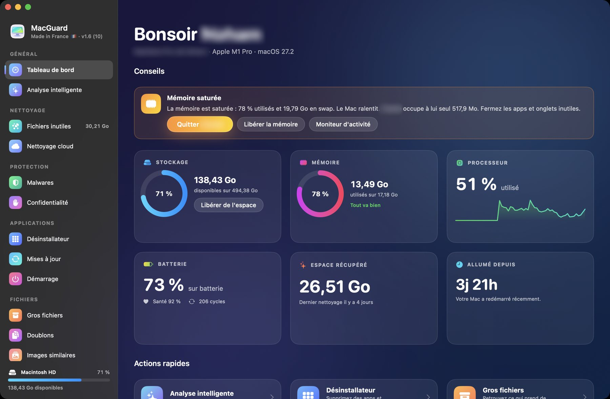

<h1 align="center">MacGuard</h1>

Clean, uninstall, protect and monitor your Mac from a single app. <strong>Completely free, with no ads and no trackers.</strong>

  <a href="https://github.com/gorepair/MacGuard-releases/releases/latest/download/MacGuard.dmg"><strong>Download for Mac</strong></a>
  &nbsp;|&nbsp; <a href="https://gorepair.github.io/MacGuard-releases/en/">Website</a>
  &nbsp;|&nbsp; <a href="README.md">Français</a>

Available in English and French.

## What MacGuard does

- **Junk files**: caches, logs, developer files, app leftovers.
- **Uninstaller**: every app with its size, when you last opened it and the files it leaves behind.
- **Malware**: apps and downloads checked against Apple's signatures (XProtect), macOS protections verified.
- **Menu bar**: temperatures, disk, processor, memory, network and charging, live.
- **Also**: smart scan, duplicates, large files, similar images, space explorer, cloud cleanup, privacy, maintenance, app updates.

## Your files

- A confirmation before every removal.
- The Trash by default, and undo for the last cleanup.
- Your exclusions stay untouched.

## Install

Requires **macOS 14 or later** on an **Apple silicon Mac**.

1. [Download the DMG](https://github.com/gorepair/MacGuard-releases/releases/latest/download/MacGuard.dmg), open it and drag MacGuard into Applications.
2. On first launch, macOS blocks it because the app is not notarized yet. Open **System Settings › Privacy & Security**, then choose **Open Anyway**.
3. After that, MacGuard updates itself in one click.

Made in France.
