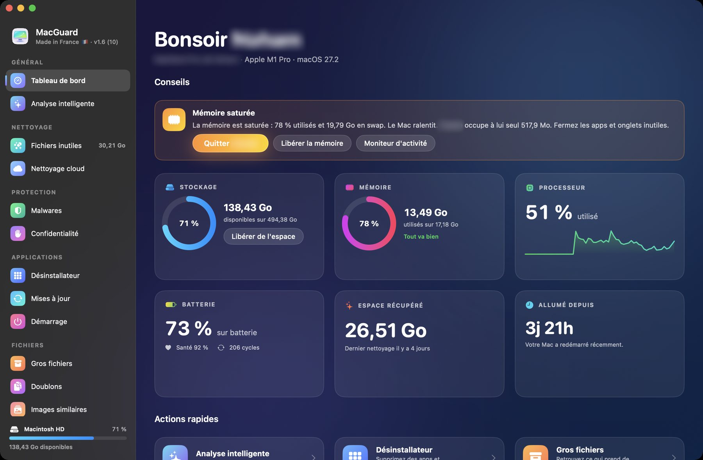

<h1 align="center">MacGuard</h1>

Nettoyez, désinstallez, protégez et surveillez votre Mac depuis une seule app.

  <a href="https://github.com/gorepair/MacGuard-releases/releases/latest/download/MacGuard.dmg"><strong>Télécharger pour Mac</strong></a>
  &nbsp;|&nbsp; <a href="https://gorepair.github.io/MacGuard-releases/">Site</a>
  &nbsp;|&nbsp; <a href="README.en.md">English</a>

## Ce que fait MacGuard

- **Fichiers inutiles** : caches, journaux, fichiers de développement, restes d'apps.
- **Désinstallateur** : chaque app avec sa taille, sa dernière ouverture et les fichiers qu'elle laisse.
- **Malwares** : apps et téléchargements comparés aux signatures d'Apple (XProtect), protections de macOS vérifiées.
- **Barre de statut** : températures, disque, processeur, mémoire, réseau et charge, en direct.
- **Et aussi** : analyse intelligente, doublons, gros fichiers, images similaires, explorateur d'espace, nettoyage cloud, confidentialité, maintenance, mises à jour d'apps.

## Vos fichiers

- Une confirmation avant chaque suppression.
- La Corbeille par défaut, et l'annulation du dernier nettoyage.
- Vos exclusions restent intouchables.

## Installer

Nécessite **macOS 14 ou plus récent** sur un **Mac à puce Apple**.

1. [Téléchargez le DMG](https://github.com/gorepair/MacGuard-releases/releases/latest/download/MacGuard.dmg), ouvrez-le et glissez MacGuard dans Applications.
2. Au premier lancement, macOS le bloque car l'app n'est pas encore notarisée. Ouvrez **Réglages Système › Confidentialité et sécurité**, puis choisissez **Ouvrir quand même**.
3. Ensuite, MacGuard se met à jour tout seul, en un clic.

Fait par Noham, en France.
